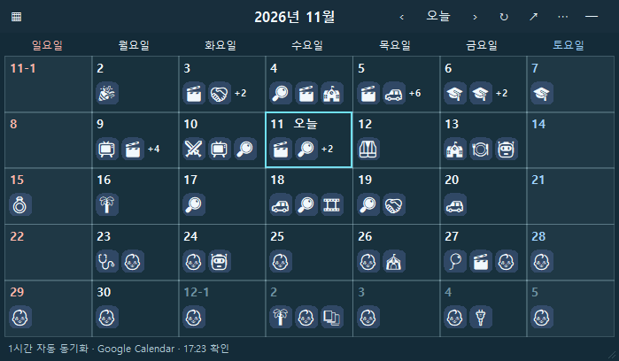

# - 팀 캘린더 위젯

Windows 바탕화면에 붙이는 독립 실행 앱으로, Google 캘린더 일정을 긁어와 쓸 수 있습니다.

Google 일정 읽기에는 두 방식 중 하나를 선택하며, 아래에 설명합니다.

## 설치

[다운로드](https://github.com/weedc/desktop-calendar-widget/releases)에서 운영체제에 맞는 ZIP을 받습니다. Google Chrome이 필요합니다.

| 운영체제 | 설치 방법 |
| --- | --- |
| Windows | ZIP을 풀고 `powershell -ExecutionPolicy Bypass -File .\install.ps1` 실행. 바탕화면의 **팀 캘린더 위젯**으로 시작합니다. |
| macOS 14 이상 | Apple Silicon은 `mac-arm64`, Intel은 `mac-x86_64` ZIP을 선택하고 앱을 **응용 프로그램**으로 옮깁니다. |

Mac에서 실행이 차단되면 **시스템 설정 → 개인정보 보호 및 보안**에서 열기를 허용합니다. Google 연결 시 Chrome 제어 권한을 허용하고, Chrome **보기 → 개발자 → Apple Events의 JavaScript 허용**을 켭니다.

## 처음 시작하기

**연결 방식 선택 → 캘린더 선택 → 시작하기** 순서로 진행합니다. 이후에는 상단 **⋯ → 설정**에서 변경합니다.

체크박스와 설정 변경은 마지막 **시작하기 / 적용**을 눌러야 반영됩니다. **취소**하면 기존 설정을 유지합니다. 알림·투명도·글자 크기·자동 실행은 **고급 설정**에 있습니다.

# ① Google 계정 연동 — ID 입력 없이 선택

1. **Google 계정 연결**을 누릅니다.
2. 열린 Google 화면에서 로그인한 뒤, 필요하면 연결 버튼을 다시 누릅니다.
3. 사용할 캘린더에 체크하고 **시작하기 / 적용**을 누릅니다.

# ② 캘린더 ID 직접 입력

1. **캘린더 ID 입력**을 선택합니다.
2. Google Calendar의 **설정 → 캘린더 통합**에서 복사한 ID를 넣습니다. 여러 개는 **추가**로 넣습니다.
3. 사용할 캘린더에 체크하고 **시작하기 / 적용**을 누릅니다.

두 연결 방식 중 하나를 사용합니다. 전환해도 다른 방식의 목록은 보관하며, 같은 캘린더를 중복으로 읽지 않습니다.

## 사용법

| 조작 | 동작 |
| --- | --- |
| 상단 빈 곳 드래그 · 모서리 드래그 | 이동 · 크기 조절 |
| ‹ / › · 오늘 · 연월 | 달 이동 · 이번 달 · 원하는 달 선택 |
| ↻ / F5 | 수동 새로고침 |
| 날짜 더블클릭 | 상세 일정·개인 메모. 다른 날짜를 더블클릭하면 같은 창에서 전환 |
| ─ | 숨기기. Windows 트레이 / Mac 메뉴 막대 아이콘에서 복원 |

개인 메모는 자동 저장되며 색상 둥근 사각형으로 표시됩니다. 중요한 일정과 날짜는 따로 강조할 수 있습니다. Google 원본 일정의 추가·편집·삭제는 Google Calendar에서 합니다.

작은 창에서만 일정이 **이모지**로 바뀌고, 넓히면 **원문**을 표시합니다. 마우스를 올리거나 날짜를 더블클릭하면 자세히 볼 수 있습니다. 이모지는 일정 상세에서 직접 바꿀 수 있으며, 고급 설정에서 이모지 표시를 끌 수도 있습니다.

## 동기화와 알림

자동 동기화는 **1시간 간격**입니다. 고급 설정에서 끌 수 있으며, 꺼도 수동 새로고침은 가능합니다.

**고급 설정 → 새 버전 업데이트 알림**에서 업데이트 알림을 켜고 끌 수 있습니다. 실행 시와 6시간마다 확인하며, **지금 확인**은 알림을 꺼도 사용할 수 있습니다. 알림을 누르면 내 운영체제에 맞는 다운로드가 열립니다.

**매일 일정 요약**의 시각과 **시작 1시간 전 알림**을 각각 설정할 수 있습니다. 알림은 Windows / macOS 시스템 알림으로 전달됩니다. 시각은 **한국 시간** 기준이며, PC가 깨어 있고 위젯이 실행 중이어야 합니다. 자동 동기화를 끄면 저장된 일정으로 알립니다.

# - 각 사용자의 Codex/Dot 연동 (선택)

**고급 설정 → 적용 후 Codex · Dot 설정 → 돌아가기 → 적용**으로 연동창을 엽니다.

- **Codex 연동하기**로 자신의 Codex에 연결합니다. 도구가 보이지 않으면 Codex를 다시 엽니다.
- **이모지 정리 요청**을 전송하면 새 일정의 맥락을 분류해 저장합니다. 같은 내용은 재사용하며, 창 크기를 바꿀 때마다 AI를 호출하지 않습니다.
- **연동 해제**로 이 위젯의 연결만 끌 수 있습니다.

일반 사용과 시스템 알림에는 Codex가 필요하지 않습니다. 일정과 개인 메모는 각자의 PC에 저장됩니다.
